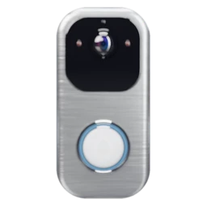
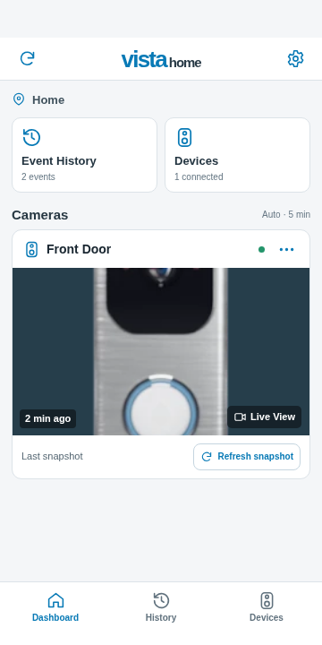

<div align="center">



# Vista Home · WHIP Doorbell

**A smart video doorbell and two-way intercom for FiveM roleplay servers running WHIP.**

  

Install a doorbell on your property, receive alerts on your WHIP phone, check real in-game camera snapshots and speak to visitors from wherever your character is.

[Installation](#installation) · [Features](#features) · [Player guide](#player-guide) · [Configuration](#configuration) · [Troubleshooting](#troubleshooting)



<sub>Vista Home 2.0.7 browser UI preview using a sample image. In-game snapshots show the actual doorbell camera scene.</sub>

</div>

## Features

| Feature | Description |
| --- | --- |
| Native WHIP integration | Inventory item, world interactions, phone app, notifications and in-game settings. |
| Installable smart doorbells | Wall placement preview and three finishes: satin nickel, Venetian bronze and satin black. Illuminated variants, door chime and siren. |
| Vista Home | Camera-first dashboard, device management, event history and dedicated camera controls. |
| Real camera snapshots | Native WHIP screenshot capture, saved preview images and timestamps. No `screenshot-basic` dependency. |
| Automatic previews | Refresh stale snapshots while the app is open; configurable 5–10 minute interval. |
| Two-way intercom | Actual player-to-player voice through `whip_voice`, with a telephone-band audio filter. |
| Security alerts | Doorbell rings, motion alerts and phone notifications. |
| Household sharing | Owners can grant/revoke access for online characters. |
| Persistence | Installed devices, ownership, sharing, event history and latest snapshots are saved locally on the server. |
| Network safeguards | Bounded image size, latent image transfers, rate limits and capture cooldowns. |

## Requirements

- FiveM server with working WHIP character and inventory systems.
- `whip_core`, including the native client `TakeScreenshot` export and satellite API.
- `whip_phone`, with external module registration, push messages and notifications.
- `whip_voice`, with the voice-line API.

This release targets WHIP only. QBCore, Qbox, ESX, ox_lib, ox_inventory and screenshot-basic are not required or supported by this integration. Exact minimum WHIP release numbers have not been established; use mutually compatible versions of the WHIP resources above.

## Installation

1. Download the release ZIP or clone the repository into your server resources directory. The actual resource folder must be named `whip_doorbell`, with `fxmanifest.lua` directly inside it. Do not leave a nested `whip_doorbell/whip_doorbell` folder.
2. Stop any older `vista_doorbell` resource to avoid duplicate devices and interactions. If upgrading an existing WHIP installation, **back up and retain `data/doorbells.json`** before replacing the resource files.
3. Add these entries in dependency order to `server.cfg` (do not duplicate existing ensures):

   ```cfg
   ensure whip_core
   ensure whip_voice
   ensure whip_phone
   ensure whip_doorbell
   ```

4. Start the server, or run `refresh` and `ensure whip_doorbell` in the server console. The resource registers `vista_doorbell` automatically. The bundled inventory image is `html/img/items/vista_doorbell.webp`.
5. Find **Vista Doorbell** in `/whip` → Economy → Items. Give the item to a character or add it to a shop through your existing WHIP shop system.
6. Open the regular WHIP phone and look for **Vista Home**. If the phone was already running an older module, close it, then restart `whip_phone` followed by `whip_doorbell`.

A clean install starts without any devices. The resource creates its own `data/doorbells.json` as it saves data; no SQL import is required by this resource.

## Player guide

### Install your doorbell

Use the Vista Doorbell inventory item while standing near a wall. Aim at a valid wall surface, use the left/right arrow keys to select a finish, press Enter to confirm or Backspace to cancel. Exactly one item is removed after a successful server-validated installation. Cancelled or invalid placements do not consume it.

### View your front door

Open Vista Home. Tap the camera tile to open Live View, or tap **Refresh snapshot** to capture a new saved image. The first capture may briefly switch the game camera and then restore the phone camera. Subsequent opens retrieve the last saved snapshot. Automatic refresh is enabled by default while Vista Home is visible and unlocked; overdue previews are checked when you reopen the app.

### Answer a visitor

A visitor uses the WHIP interaction on the installed device and stays nearby. The owner or a shared user receives a phone alert and can choose **Answer visitor**. Both parties speak using their normal voice key (N by default). The visitor can end the conversation at the door; the answering player can end it from the phone. Moving out of range, disconnecting, expiry, revoked access or closing the app ends the session.

### Manage devices

Use the Devices tab or the three-dot menu to rename your doorbell, toggle motion alerts, share access using an online player's server ID, revoke access or remove the device. Stand next to the installed unit to remove it and reclaim the inventory item. Event History can be filtered by device or event type. Camera controls also provide a siren and GPS waypoint.

## Configuration

Open `/whip` → Settings → **Vista Doorbell**. Settings are registered by `settings.lua`; defaults are in `config.lua`. See the [complete settings reference](docs/CONFIGURATION.md).

| Setting | Default |
| --- | --- |
| Devices per character | 5 |
| Automatic previews | Enabled |
| Snapshot interval | 5 minutes (5–10 adjustable) |
| Ring cooldown | 6 seconds |
| Motion range / cooldown | 6 m / 60 seconds |
| Visitor answer window | 45 seconds |
| Intercom range / session limit | 4 m / 180 seconds |
| History limit | 60 entries per device |
| Show visitor names | Disabled |

## Important behaviour

- Snapshots are saved still images, not a continuous video feed. Automatic capture runs only while Vista Home is open and eligible; it does not capture when everyone is offline. It defers during movement, driving, active calls, live view and other busy conditions.
- Live View uses the GTA scripted camera behind the phone, not a video stream embedded inside the physical DUI screen. Camera access requires the same routing bucket, and distant entities may be limited by GTA/OneSync streaming.
- Event History is an activity log, not recorded video playback. No cloud service, subscription or real Ring device connection is included.
- The server saves the latest preview and bounded event history locally. Do not publish live data or backups. See [data and privacy](docs/DATA_AND_PRIVACY.md).
- Actual idle and active resmon values depend on your server, device count and client hardware. No specific performance benchmark is claimed.

## Troubleshooting

| Problem | What to check |
| --- | --- |
| App missing or outdated | Check dependency startup order and restart `whip_phone`, then `whip_doorbell`. |
| Item missing | Check item registration and server console errors. Use `/whip` item management to give the item. |
| No snapshot | Keep the app open, leave Live View, remain in the same routing bucket and press Refresh snapshot. Confirm `TakeScreenshot` exists in your WHIP core. Check F8 for `[whip_doorbell] preview failed:`. |
| Auto-refresh not running | Check `/whip` settings; automatic capture requires the app to be visible and the character not busy. |
| No voice | Test `whip_voice` independently, check `/voicecheck` if available, and have the visitor ring and stay within range. |
| Doorbells missing after update | Restore the backed-up WHIP `data/doorbells.json`. Temporary routing buckets may change across restarts. |

For a reproducible bug, include the release version, WHIP resource versions, steps to reproduce and relevant F8/server console errors. Remove private character data and identifiers before sharing logs.

## Development and releases

- [Changelog](CHANGELOG.md)
- [Release notes](docs/RELEASE_NOTES.md)
- [Testing checklist](docs/TESTING.md)
- [Contributing](CONTRIBUTING.md)
- [Security reporting](SECURITY.md)

The repository includes a GitHub Actions workflow for Lua and JavaScript syntax checks. These are static checks; they do not run a FiveM server or verify multiplayer voice, camera rendering or frame rates.

## Credits and distribution

Vista Home is a WHIP-compatible adaptation of the supplied Vista Doorbell resource. It uses the original supplied doorbell model and texture assets and an original Vista-branded interface inspired by smart-home security applications. WHIP, FiveM, GTA and Ring are referenced descriptively; this project is not an official Ring product or affiliated with Ring.

No redistribution or open-source licence has been selected for this package. Confirm that you have permission to redistribute the original resource and model/texture assets before sharing or publishing. See [distribution notes](docs/DISTRIBUTION.md).
